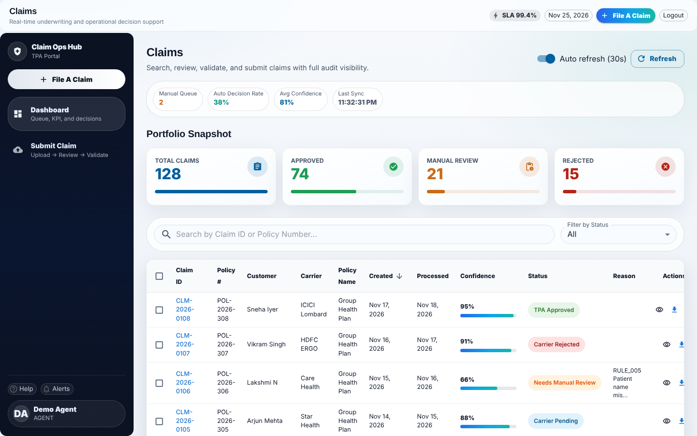
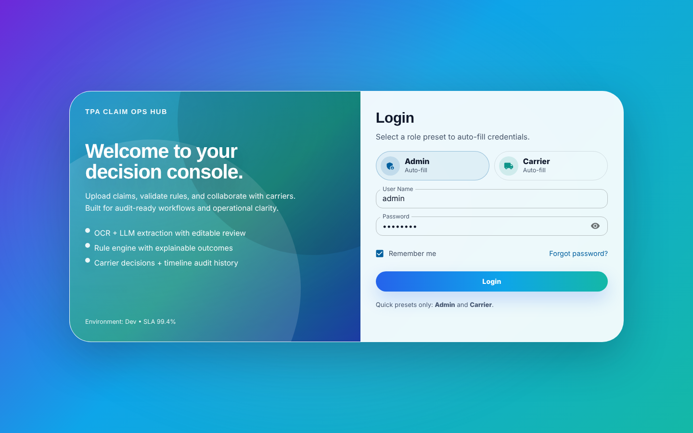
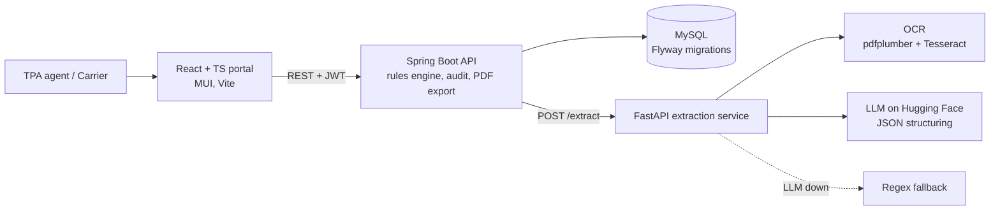
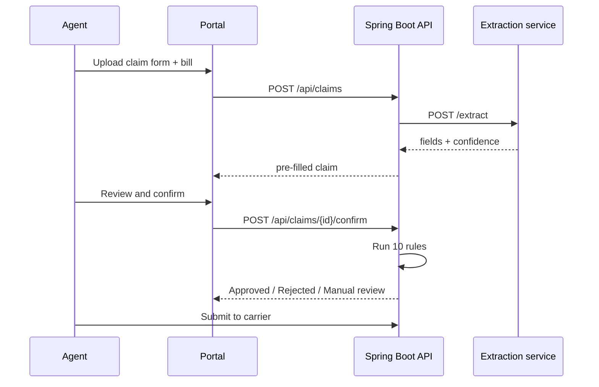

<div align="center">

# CLAIMops

**AI-assisted insurance claims processing for a Third-Party Administrator (TPA), with a carrier portal.**

OCR + LLM extraction → human review → a 10-rule policy engine → carrier hand-off, all tracked on one dashboard.

[](https://github.com/kiran-kumars953/claimops-showcase/actions/workflows/ci.yml)
[](LICENSE)


</div>

---



<details>
<summary>Login screen</summary>



</details>

<sub>Screenshots use sample data.</sub>

## Why

A TPA agent typically re-keys every claim form and hospital bill by hand, then checks it against the policy. CLAIMops reads both documents, pre-fills the claim, flags mismatches, and only asks a human to decide the cases that genuinely need judgement.

## Features

- **Two-document intake**: claim form plus combined discharge summary and final bill (PDF or image).
- **OCR + LLM extraction**: `pdfplumber` / Tesseract text, structured into JSON by an LLM on Hugging Face, with a **regex fallback** when the LLM is unavailable.
- **Confidence score** (0 to 1) built from OCR success, field coverage and cross-document consistency.
- **Human-in-the-loop review**: the agent edits extracted fields before any rule runs.
- **Rule engine**: 10 mandatory rules (missing documents, inactive policy, name, hospital and date mismatches, over-billing, high-value and possible duplicate claims) decide *Approved*, *Rejected* or *Needs Manual Review*.
- **Carrier portal**: role-based login, carrier review queue, approve or reject with reason, full audit trail.
- **Exports**: decision report PDF per claim.
- **Security**: JWT auth, role-based routes, BCrypt passwords, Flyway-managed schema.

## Architecture



Claim lifecycle:



More detail: [architecture](docs/ARCHITECTURE.md) · [business rules](docs/BUSINESS_LOGIC.md) · [technical notes](docs/TECHNICAL_DOCUMENTATION.md)

## Tech stack

<table align="center">
<tr><td><b>Frontend</b></td><td><table><tr><td align="center" width="80"><br/>React</td><td align="center" width="80"><br/>TypeScript</td><td align="center" width="80"><br/>Vite</td><td align="center" width="80"><br/>Material UI</td><td align="center" width="80"><br/>React Router</td></tr></table></td></tr>
<tr><td><b>Backend</b></td><td><table><tr><td align="center" width="80"><br/>Java</td><td align="center" width="80"><br/>Spring Boot</td><td align="center" width="80"><br/>Spring Security</td><td align="center" width="80"><br/>JWT</td><td align="center" width="80"><br/>Hibernate</td><td align="center" width="80"><br/>Flyway</td><td align="center" width="80"><br/>iText / PDFBox</td></tr></table></td></tr>
<tr><td><b>AI service</b></td><td><table><tr><td align="center" width="80"><br/>Python</td><td align="center" width="80"><br/>FastAPI</td><td align="center" width="80"><br/>pdfplumber</td><td align="center" width="80"><br/>Tesseract</td><td align="center" width="80"><br/>Hugging Face</td></tr></table></td></tr>
<tr><td><b>Data / Delivery</b></td><td><table><tr><td align="center" width="80"><br/>MySQL</td><td align="center" width="80"><br/>Docker</td><td align="center" width="80"><br/>GitHub Actions</td></tr></table></td></tr>
</table>

| Layer | Tech |
|---|---|
| Frontend | React 19, TypeScript, Vite, Material UI, React Router |
| Backend | Java 17, Spring Boot 3.2, Spring Security (JWT), JPA/Hibernate, Flyway, iText / PDFBox |
| AI service | Python, FastAPI, pdfplumber, pytesseract, Hugging Face Inference |
| Data | MySQL 8 |
| Delivery | Docker Compose, GitHub Actions |

## Project structure

```
Backend/          Spring Boot API (claims, rules, carrier, auth, PDF export)
frontend-tpa/     Unified TPA + carrier portal (React + TypeScript)
Python-Service/   OCR + LLM extraction service (FastAPI) and its tests
docs/             Architecture, business rules, technical notes
docker-compose.yml
```

## Run it

**Prerequisites:** Docker and Docker Compose. A free Hugging Face token is optional: without one, extraction falls back to regex.

```bash
git clone https://github.com/kiran-kumars953/claimops-showcase.git
cd claimops-showcase
cp .env.example .env      # then fill in your own values
docker compose up --build
```

| Service | URL |
|---|---|
| Portal | http://localhost:5173 |
| API + Swagger UI | http://localhost:8080/swagger-ui.html |
| Extraction service | http://localhost:5000 |

On first start the backend seeds **local demo users** (for example `admin` and `carrier`, see `DataInitializer.java`). They exist only for local development; change them before deploying anywhere.

### Run services individually

```bash
# Extraction service
cd Python-Service && pip install -r requirements.txt && uvicorn main:app --port 5000

# Backend (needs a local MySQL; reads DB_USER, DB_PASSWORD, JWT_SECRET from the environment)
cd Backend && mvn spring-boot:run

# Frontend
cd frontend-tpa && npm ci && npm run dev
```

## Tests and checks

```bash
cd Python-Service && pip install -r requirements.txt pytest ruff && ruff check . && pytest -q
cd frontend-tpa && npm ci && npm run lint && npm run build
cd Backend && mvn -B verify
```

The Python suite covers LLM JSON cleanup, date normalisation, the regex fallback, field merging, confidence scoring and the end-to-end extraction flow with OCR and the LLM mocked. CI runs all three on every push and pull request.

## Roadmap

- [ ] Unit tests for the Java rule engine (storage layer covered)
- [x] Replace `any` types in the frontend API layer with typed DTOs
- [ ] Async extraction queue for large batches
- [ ] Carrier callback webhooks with signature verification

## License

[MIT](LICENSE) © Kiran Kumar S
