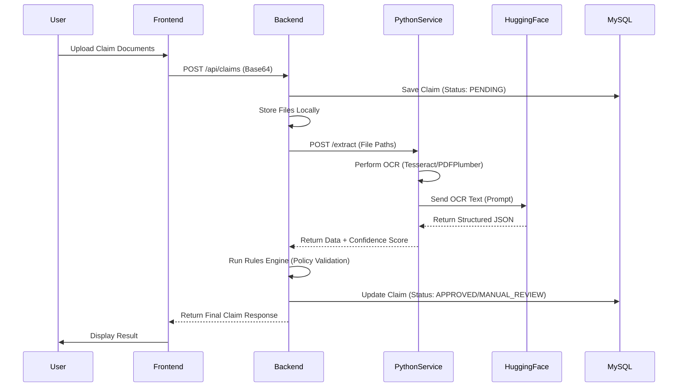

# Technical Architecture & Workflow Documentation

## Overview
The TPA (Third Party Administrator) Claims Processing System is a multi-service application designed to automate the extraction and validation of insurance claims from medical documents using OCR and Large Language Models (LLMs).

---

## 🏗 System Architecture

The system consists of three main components:

### 1. Frontend (React)
- **Tech Stack**: React 18, TypeScript, Vite, Material UI (MUI).
- **Responsibility**: Provides a modern dashboard for managing claims and a dedicated upload interface for document submission.
- **Key Files**:
    - [App.tsx](frontend-tpa/src/App.tsx): Main navigation and layout.
    - [Upload.tsx](frontend-tpa/src/pages/Upload.tsx): Handles file selection and multi-part submission.

### 2. Backend (Spring Boot)
- **Tech Stack**: Java 17, Spring Boot 3.2, MySQL, Flyway (DB migration), JPA/Hibernate.
- **Responsibility**: Orchestrates the business logic, manages the database, and coordinates integrations with the AI service and external carriers.
- **Key Modules**:
    - **Service Layer**: [ClaimServiceImpl](Backend/src/main/java/com/tpa/claims/service/ClaimServiceImpl.java) manages the end-to-end claim lifecycle.
    - **AI Integration**: [PythonIntegrationServiceImpl](Backend/src/main/java/com/tpa/claims/processing/PythonIntegrationServiceImpl.java) handles communication with the FastAPI service.
    - **Rules Engine**: [RuleEngineServiceImpl](Backend/src/main/java/com/tpa/claims/rules/RuleEngineServiceImpl.java) validates claims against insurance policies.
    - **Storage**: [StorageService](Backend/src/main/java/com/tpa/claims/storage/StorageService.java) manages physical file storage.

### 3. AI Service (Python)
- **Tech Stack**: FastAPI, PyTesseract (OCR), PDFPlumber, Hugging Face Hub (LLM).
- **Responsibility**: Extracts raw text from documents and uses a Large Language Model to structure the data into a standardized JSON format.
- **Key Modules**:
    - [ocr.py](Python-Service/ocr.py): Local OCR extraction logic.
    - [llm.py](Python-Service/llm.py): Integration with Hugging Face Zephyr-7B-Beta for data structuring.
    - [extractor.py](Python-Service/extractor.py): Calculates extraction confidence scores.

---

## 🔄 End-to-End Workflow

---

## 🛡 Security & Configuration
- **CORS**: Configured in both Spring Boot ([SecurityConfig](Backend/src/main/java/com/tpa/claims/config/SecurityConfig.java)) and FastAPI to allow cross-origin requests from the React development server.
- **Environment Variables**: Managed via `.env` in the Python service and `application.yml` in the Backend.
- **Database Migrations**: Flyway ensures consistent schema updates across all environments.

---

## 📊 Confidence Scoring Logic
The extraction quality is assessed based on three factors:
1. **OCR Success (30%)**: Percentage of documents successfully processed.
2. **Key Data Presence (40%)**: Identification of essential fields like Policy # and Patient Name.
3. **Format Validation (30%)**: Checking if the Policy Number matches the `POL-YYYY-NNN` standard.
